  

# 💳 Awesome Billing Operations & Admin Consoles

  
  
  
  

> 🚀 **The definitive directory of billing operations platforms, subscription management admin consoles, quote-to-cash workflows, usage metering engines, and self-hosted open-source billing portals.**

Whether you are evaluating commercial enterprise SaaS billing engines or deploying open-source, self-hosted administrative panels for subscription monetization and automated dunning, this curated guide provides structured benchmarks, transparent pricing metrics, and valuation indicators.

---

## 📑 Contents

- [📊 Sector Overview & Market Dynamics](#-sector-overview--market-dynamics)
- [🏢 SaaS Billing Platforms](#-saas-billing-platforms)
- [💻 Open-Source Billing Platforms & Admin Consoles](#-open-source-billing-platforms--admin-consoles)
- [📈 Star History](#-star-history)
- [💖 Support & Sponsor](#-support--sponsor)
- [🤝 Contributing](#-contributing)

---

## 📊 Sector Overview & Market Dynamics

The global subscription and billing management software market was valued between **$6.9 Billion and $8.8 Billion** in 2024–2025 and is projected to expand at a compound annual growth rate (**CAGR**) of **14% to 16.9%**, reaching approximately **$18 Billion by 2030**. 

The sector exhibits **moderate concentration**: while high-tier enterprise infrastructure is anchored by a select group of heavyweight leaders (such as Stripe, Zuora, and Chargebee) capturing substantial revenue volume, the broader landscape remains **significantly fragmented** due to a surge in specialized usage-based metering platforms, vertical SaaS Merchant of Record (MoR) solutions, and modern self-hosted open-source billing engines catering to developer-first and privacy-focused architectures.

---

## 🏢 SaaS Billing Platforms

The following commercial SaaS billing platforms bundle administrative consoles as their core operations control plane. Entries are sorted in **descending order by company valuation / annual revenue scale**:

| 🏢 Platform | 🖥️ Admin Console / Interface | 💰 Specific Pricing / Starting Tier | 🎁 Free Tier / Free Trial Limits | 📈 Scale (Valuation / Revenue) |
|---|---|---|---|---|
| **[Stripe](https://stripe.com)** | Stripe Dashboard (payments, recurring subscriptions, invoices, and revenue recovery) | **0.70%** of recurring volume for Stripe Billing Starter; **$0.02 to $0.05 per active entitlement** for usage metering; card processing is **2.9% + 30¢** per successful transaction. | **Free for life**: No monthly platform fee. Test mode / sandbox is 100% free with unlimited API calls and mock testing. Pay-as-you-go per collected transaction. | **~$91.5B valuation** (2025 tender offer) / **$14B+ net revenue** |
| **[Chargebee](https://www.chargebee.com)** | Chargebee Admin Console (subscription lifecycle, churn prevention, catalog management) | **$99/month + 0.65%** of volume on Starter plan (or Starter Flow at $0 base + 0.80% overage); Performance plan starts at **$599/month**. | **Free for life / Launch tier**: Free for your first **$250,000 in cumulative lifetime billing** (0% platform charge during launch limit); test sandbox fully accessible. | **$3.5B valuation** (Series H) / **~$200M+ ARR** |
| **[Zuora](https://www.zuora.com)** | Zuora Central Billing Console (quote-to-revenue automation, ASC 606 revenue recognition) | Starting enterprise contract tier averages **~$1,000 to $1,500/month** ($12,000–$18,000/year base platform fee), scaling with volume tiers and add-on modules. | **Free trial only**: **30-day sandbox trial** with simulated test billing cycles, mock gateways, and product catalog configuration; no permanent free tier. | **$1.7B acquisition valuation** (Silver Lake / GIC buyout) / **~$450M ARR** |
| **[Paddle](https://www.paddle.com)** | Paddle Vendor Dashboard (Merchant of Record, checkout localized tax, SaaS billing) | **5% + 50¢** flat per successful transaction across worldwide sales; covers localized VAT/GST compliance and payment gateway fees. | **Free for life**: Zero setup fee and $0 monthly fixed platform charge. Unlimited sandbox testing environment; fees apply only when real customer payments clear. | **$1.4B valuation** (Series D) / **~$90M+ ARR** |
| **[FastSpring](https://fastspring.com)** | FastSpring Operations Portal (full-service MoR, localized checkout, subscription management) | **8.9% flat** per transaction or **5.9% + 95¢ per transaction** (custom negotiated rates for volume accounts >$1M annual gross merchandise value). | **Free trial only**: **14-day interactive sandbox access** for testing checkouts, APIs, and subscription cycles. $0 monthly software fee for active accounts. | **PE-backed (Accel-KKR / LLR)** / **~$50M–$100M revenue** ($1B+ GMV) |
| **[BillingPlatform](https://billingplatform.com)** | BillingPlatform Operations Console (usage-based rating, hybrid mediation, contract billing) | Enterprise deployment contracts starting at **~$4,800/installation** (annual platform subscription packages typically start at **$25,000+/year**). | **Free trial only**: No permanent free tier. Custom **14-day assisted pilot / sandbox proof-of-concept** available upon consultation with technical architecture team. | **$104M funding (FTV Capital)** / **~$30M–$45M revenue** |
| **[Recurly](https://recurly.com)** | Recurly Admin Console (dunning engine, churn management, subscriber analytics) | **$249/month + 0.90%** of transaction volume on Starter Plan; Professional tier custom quote based on volume. | **Free trial only**: **14-day free trial** with access to core subscriber management features and sandbox gateway testing; no free-for-life tier. | **PE-backed (Accel-KKR)** / **~$56M annual revenue** ($1.3B+ recovered) |
| **[Maxio](https://www.maxio.com)** | Maxio Admin Console (merged Chargify + SaaSOptics; B2B subscription billing & SaaS metrics) | **$599/month** (billed annually) for Essentials tier covering up to $1M ARR; Growth tier scales to **$1,499+/month**. | **Free trial only**: **14-day full-feature sandbox trial** with sample customer cohorts, pricing plans, and analytics dashboards; no permanent free tier. | **PE-backed (Fulcrum Equity)** / **~$49M annual revenue** ($17B+ managed) |
| **[Ordway](https://www.ordwaylabs.com)** | Ordway Admin Console (complex billing automation, contract management, revenue recognition) | Starting at **$500/month** (~$499–$600/month base) for early growth accounts, scaling up to **$1,500+/month** for mid-market multi-entity operations. | **Free trial only**: No permanent free tier. **14-day guided sandbox demo environment** provided during solution consultation; custom proof of concept. | **$30M+ funding (Harbert / CRV)** / **~$15M–$25M revenue** |
| **[Rebilly](https://www.rebilly.com)** | Rebilly Console (payment orchestration, KYC risk rules, recurring billing automation) | **$125/month + 1%** of revenue on the Pro plan (volume tier discounts reduce revenue fee down to 0.50% at $50M+ volume); $0 transaction handling fee. | **Free trial only**: **30-day comprehensive free trial** with unrestricted sandbox testing, customer journey builders, and payment gateway simulation. | **Bootstrapped / Private** / **~$10M–$20M revenue** |

---

## 💻 Open-Source Billing Platforms & Admin Consoles

Self-hosted billing applications, modular payment orchestration engines, and developer-centric invoicing dashboards. Sorted in **descending order by GitHub Stars_Count**:

- **[Hyperswitch](https://github.com/juspay/hyperswitch)**  — ⚡ High-performance, open-source payment orchestration router with an admin dashboard to handle payments, routing, and refunds across multiple processors.
- **[Lago](https://github.com/getlago/lago)**  — 🎯 Open-source metering and usage-based subscription billing platform with an intuitive operational back-office console.
- **[Invoice Ninja](https://github.com/invoiceninja/invoiceninja)**  — 🧾 Leading open-source invoicing, billing, and client management platform with full administrative and client portals.
- **[Akaunting](https://github.com/akaunting/akaunting)**  — 📊 Free and open-source accounting and billing software for small businesses with an extensible modular admin panel.
- **[Crater](https://github.com/crater-invoice-inc/crater)**  — 📱 Open-source invoicing app for freelancers and small businesses with Vue.js/Laravel administration panels and companion mobile apps.
- **[Kill Bill](https://github.com/killbill/killbill)**  — 🏛️ Robust open-source subscription billing and payments platform designed for enterprise scale. Includes administrative interfaces via the [Kill Bill Admin UI](https://github.com/killbill/killbill-admin-ui) .
- **[InvoicePlane](https://github.com/InvoicePlane/InvoicePlane)**  — 📑 Self-hosted open-source application for managing invoices, clients, quotes, and payment collections.
- **[Paymenter](https://github.com/Paymenter/Paymenter)**  — 🖥️ Modern open-source gateway and billing platform tailored for hosting companies with built-in client and administration panels.
- **[OpenMeter](https://github.com/openmeterio/openmeter)**  — ⏱️ Cloud-native usage metering and real-time event aggregation engine for usage-based AI and developer API billing.
- **[Meteroid](https://github.com/meteroid-oss/meteroid)**  — 🚀 Open-source pricing and billing infrastructure providing subscription management, invoicing, usage-based metering, and revenue analytics.
- **[ITFlow](https://github.com/itflow-org/itflow)**  — 🛠️ Open-source IT documentation, ticketing, and billing platform with comprehensive client and invoice management.
- **[SolidInvoice](https://github.com/SolidInvoice/SolidInvoice)**  — 💎 Simple, elegant open-source invoicing solution and automated billing management application with a web-based administrative console.
- **[Open Source Billing](https://github.com/vteams/open-source-billing)**  — 💵 Clean, straightforward open-source portal for generating invoices, recurring payments, and collecting payments online.
- **[AgileBill](https://github.com/tony-landis/agilebill)**  — 📦 Open-source billing engine and provisioning software with comprehensive administration tools.
- **[Faveo Invoicing](https://github.com/faveosuite/faveo-invoicing-community)**  — 💼 Open-source platform for SaaS billing and software license management built on Laravel.
- **[UniBee](https://github.com/UniBee-Billing/unibee)**  — 🐝 Open-source recurring billing and subscription management platform with merchant and [Admin Portal](https://github.com/UniBee-Billing/unibee-admin-portal)  front-ends.
- **[Jetstream Cashier Billing Portal](https://github.com/renoki-co/jetstream-cashier-billing-portal)**  — 🛍️ Billing portal package for Laravel Jetstream tracking subscription quotas, plans, and seats.
- **[PNLCS](https://github.com/Panelica/pnlcs)**  — 🌐 Open-source hosting billing system and client portal alternative to WHMCS built on Laravel.
- **[Autumn (Summer)](https://github.com/useautumn/summer)**  — 🍂 Developer billing and usage-tracking toolkit designed to sit cleanly between Stripe and modern SaaS apps.
- **[BillKu](https://github.com/ribato22/BillKu)**  — 🏢 SME billing, invoicing, and operations management dashboard built on NestJS and Next.js.
- **[Liberu Billing](https://github.com/liberusoftware/project-billing-laravel-inertia-react)**  — 🧩 Modular billing and invoicing application built on Laravel, Inertia, and React.

---

## 📈 Star History

---

## 💖 Support & Sponsor

Thank you so much for visiting and using this resource! 🙏

If you found this curated list helpful for your billing architecture, evaluations, or open-source projects, please consider:
- ⭐ **Starring** the repository to support visibility and growth
- 🍴 **Forking** it to keep your own copy and share improvements
- 📢 **Sharing** it with teammates, DevOps, and fintech developers
- ☕ **Sponsoring or buying a coffee** via the [GitHub Sponsor Dashboard](https://github.com/sponsors/ishandutta2007)

Your support motivates continuous updates and curation of top-tier developer and operations tooling! 💙

---

## 🤝 Contributing

Contributions are warmly welcome! Whether you have spotted an emerging open-source billing dashboard, a pricing tier update, or want to expand feature coverage, please consult the [contribution guidelines](CONTRIBUTING.md) and submit a Pull Request.
